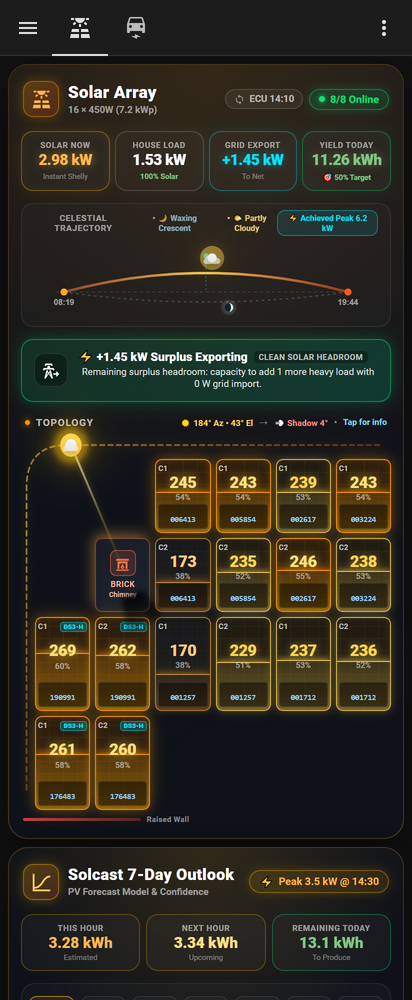
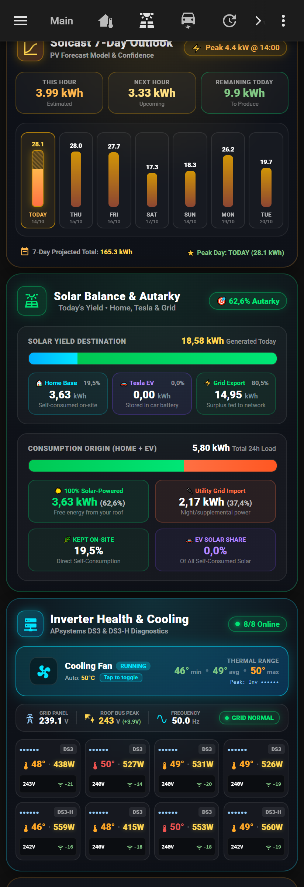
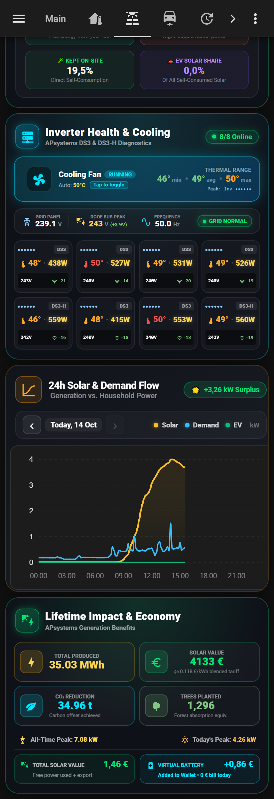

# ☀️ Home Assistant Solar & APSystems Mission Control Dashboard


A solar and microinverter monitoring dashboard for Home Assistant. Built specifically for APSystems microinverters (DS3, DS3-H, QT2, YC600) and rooftop solar setups, powered entirely by `custom:button-card` without external integration dependencies.


-orange.svg)


---


## 📸 Visual Overview


<p align="center">

  

  

  

</p>


---


## 🌟 Key Features


1. **Photovoltaic Rooftop SVG Topology Grid**:

   - Real-time per-panel generation monitoring (Watts and Module Rating percentage).

   - Dynamic 6-tier chromatic glow (from nocturnal idle cyan to peak solar flare neon orange).

   - Fluid power level waterline fill and animated PV wafer texture.

   - Interactive tap-to-inspect modal (`hass-more-info`) with mobile WebView scroll guards.

   - Landscape and Portrait panel orientations (`h` vs `v`).


2. **Diurnal Celestial Trajectory & Astronomical Arc**:

   - Real-time Sun positioning driven by Home Assistant's native `sun.sun` (azimuth & elevation).

   - Dynamic Astronomical Solar Noon computation (adapts automatically every single day across all seasons).

   - Real astronomical Moon Phase calculations and illuminated SVG lunar rendering for night hours.

   - Live weather synchronization: chromatic sun shifts (sunrise fiery orange to peak radiant white), drifting translucent clouds, and animated SVG rain/lightning storms.


3. **Volumetric Shadow Projection & Shading Engine**:

   - Architectural brick chimney obstacle embedded directly in the roof topology.

   - Volumetric soft cast shadow cone mathematically projected from real-time Sun vector and elevation (`shadow_proj_len = 34 / tan(elevation)`).

   - Intelligent shadow warning badges on panels actively obstructed by chimney or perimeter parapets.

   - Fully customizable or easy to disable if your roof is obstruction-free.


4. **Solcast PV Solar Forecast Integration**:

   - Real-time today's generation vs forecast target tracking (`% Target Achieved`).

   - Hourly production curve and 7-day weather/generation outlook.


5. **Microinverter Cluster Telemetry & Thermal Diagnostics**:

   - Complete multi-inverter telemetry matrix: real-time temperatures, AC voltages, DC channel power, and communication signal.

   - Dynamic cluster peak temperature tracking (`inverters_max_temperature`).

   - Software-debounced auxiliary active cooling fan controls (`switch.inverters_fan_plug`).


6. **24h Solar & Demand Flow with Interactive Stepper**:

   - Real-time generation vs household load curves with instant dynamic surplus/deficit badge (`+3.26 kW Surplus Exporting` / `Grid Import`).

   - Interactive historical day stepper (`< Yesterday / Today / Tomorrow >`) to review diurnal solar yield against grid demand and EV consumption.

   - 100% native vector SVG curves rendered inside `button-card` without heavy charting dependencies.


7. **Lifetime Milestones & Financial Analytics**:

   - ECU lifetime energy milestones (MWh generated, all-time peak power).

   - Stable 24-hour daylight-weighted tariff valuation (eliminates chaotic hourly tariff oscillations).

   - Environmental CO2 offset calculation and equivalent trees planted.

   - Virtual Battery / Solar Wallet accumulator tracking.


---


## 🚀 1-Click HACS Installation (Recommended)


You can now install all modular cards with **1 click via HACS**:


1. In Home Assistant, open HACS ➔ click the three dots (⋮) in the top right ➔ select **Custom repositories**.

2. Paste: `https://github.com/Aresitoo/ha-solar-apsystems-dashboard`

3. Category: **Dashboard** (or Lovelace / Plugin).

4. Click Add, find **APSystems & Solar Mission Control Cards**, and click Download.


Once installed, all modular cards are available across any of your dashboards with zero dependencies:


### 1. Rooftop Array Topology & Celestial Arc Card

```yaml

type: custom:solar-rooftop-card

```


### 2. Solcast PV Forecast & Generation Outlook Card

```yaml

type: custom:solar-forecast-card

```


### 3. APSystems Microinverter Cluster Diagnostics & Cooling Card

```yaml

type: custom:solar-inverters-card

```


### 4. Lifetime Generation Milestones & Economic ROI Card

```yaml

type: custom:solar-analytics-card

```


### 5. Unified Mission Control Deck (All Cards in One)

```yaml

type: custom:solar-mission-control-deck

```


---


## 📋 Alternative: Full YAML View Import (Raw Configuration Editor)


If you prefer to import the entire complete dashboard view as raw YAML instead of using the custom cards:


1. Install **`button-card`** via HACS (`HACS -> Frontend -> button-card`).

2. Download or copy [`solar_mission_control.yaml`](./solar_mission_control.yaml) from this repository.

3. In Home Assistant, navigate to your desired dashboard, click **Edit Dashboard** $\rightarrow$ **Raw Configuration Editor**.

4. Paste the view into your `views:` array and save.


---


## 🛠️ Complete Customization Guide


### 1. How to Add, Remove, or Reposition Solar Panels


The rooftop panel topology is defined by a clean, readable JavaScript array at the very top of **Card 0 (Array)**:


```javascript

const panelList = [

  { row: 1, col: 1, inv: "704000000001", ch: 1, id: "000001", type: "h", rating: 450, az: 206, tilt: 30, desc: "Roof West String 1" },

  { row: 1, col: 2, inv: "704000000001", ch: 2, id: "000001", type: "h", rating: 450, az: 206, tilt: 30, desc: "Roof West String 1" },

  // ... add or adjust your panels here

];

```


- `row` / `col`: Position on the grid matrix.

- `inv`: Microinverter serial number (matches Home Assistant sensor name).

- `ch`: Microinverter channel (1 or 2).

- `type`: Orientation (`"h"` for landscape, `"v"` for portrait).

- `rating`: Peak panel wattage rating (e.g. 450W).


---


## 🔒 Privacy & Security


All microinverter serial numbers in screenshots and sample configuration files are anonymized (`000001` - `000008`) to protect hardware identifiers from public indexing.


---


## 📄 License


Distributed under the MIT License. See `LICENSE` for more information.

